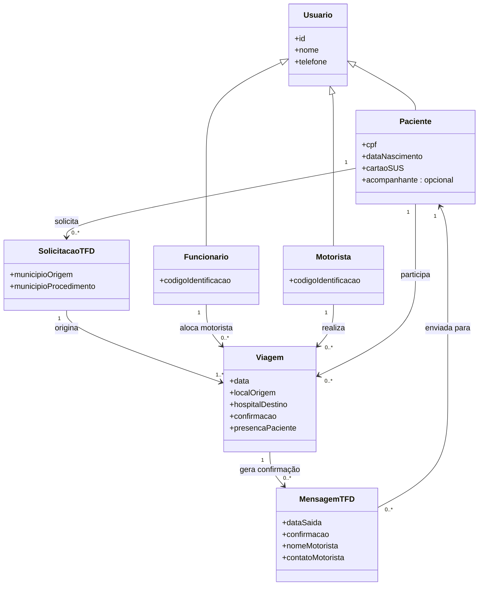

# Diagrama de Classes

O diagrama abaixo é uma **proposta inicial de modelagem**, elaborada a partir dos requisitos e das anotações da equipe. Os campos não especificados nas anotações devem ser discutidos e validados pela equipe antes da implementação.

## Observações para validar com a equipe

1. As anotações indicam que Paciente, Motorista e Funcionário são os três tipos de usuário. O diagrama usa `Usuario` como classe geral para reunir identificador, nome e telefone; essa generalização é uma decisão de modelagem proposta.
2. Para Paciente, as anotações indicam CPF, data de nascimento, Cartão do SUS e telefone. Para Motorista e Funcionário, indicam código de identificação, nome e telefone.
3. As anotações registram que a viagem contém motorista, local de origem, hospital de destino, paciente, confirmação, presença e data.
4. O acompanhante foi representado como uma informação opcional da classe `Paciente`, e não como uma classe separada.
5. A classe `SolicitacaoTFD` e a classe `MensagemTFD` organizam responsabilidades descritas nos requisitos e nas anotações. A equipe deve confirmar se elas serão implementadas como classes separadas.
